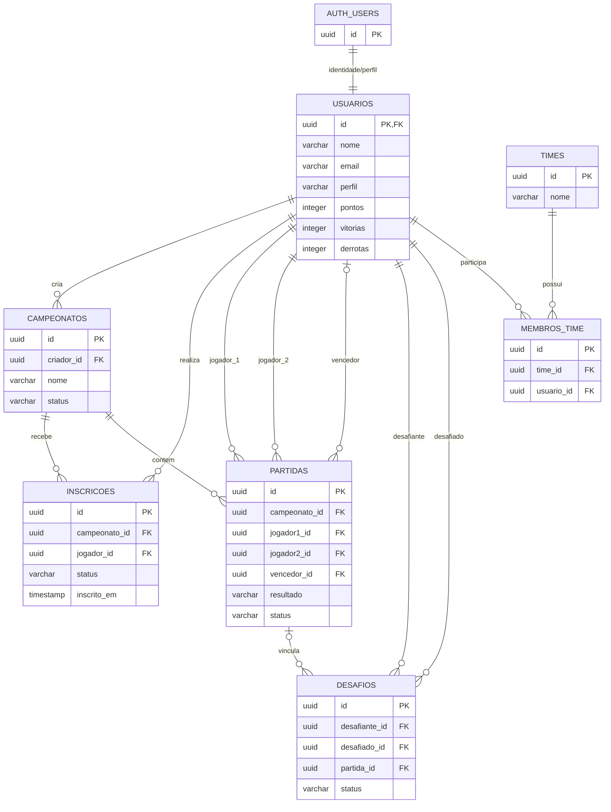

# Diagrama entidade-relacionamento

O diagrama abaixo é conceitual e preliminar. As relações devem ser conferidas com as FKs, índices e constraints do schema exportado do Supabase. Não representa as tabelas propostas de resultados/empates/auditoria como objetos existentes.

Fonte editável: [der.mmd](der.mmd).

**Atenção:** nomes/tipos de algumas colunas no desenho são ilustrativos e devem ser comparados com o DDL real. A relação desafio-partida depende da nulabilidade e unicidade de `desafios.partida_id`. A nulabilidade de `partidas.vencedor_id` para empate também precisa ser confirmada.
